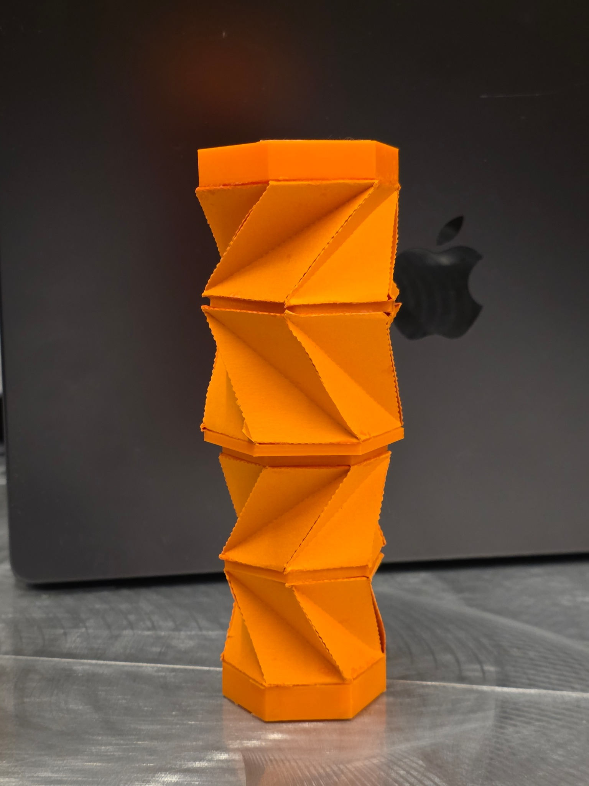
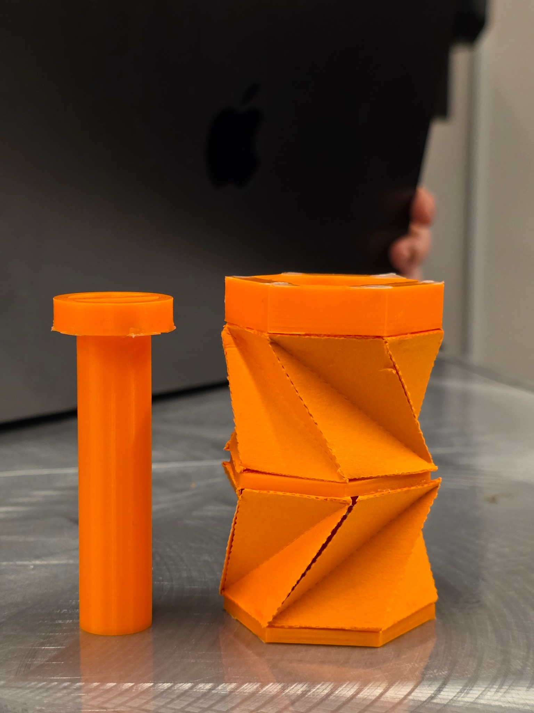
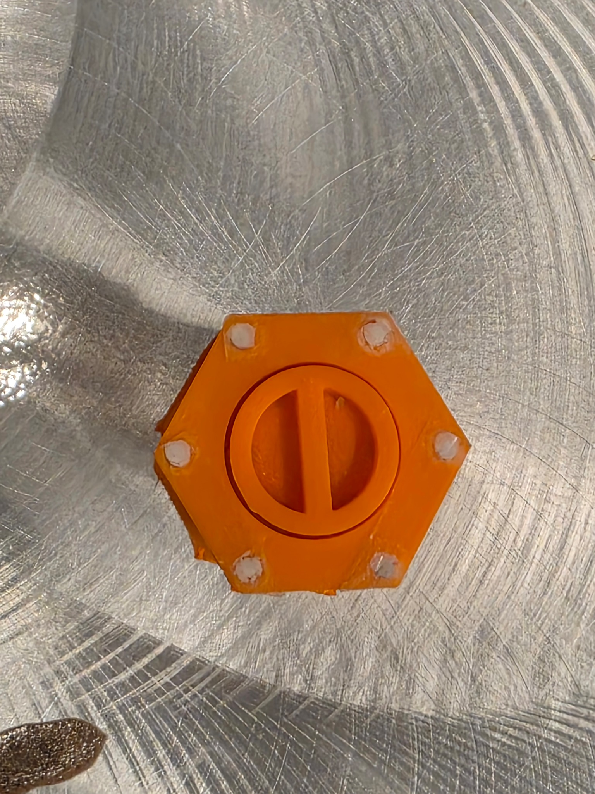
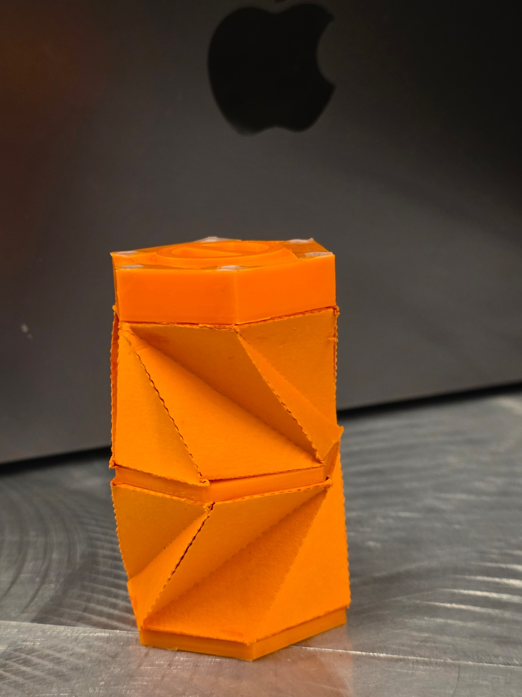
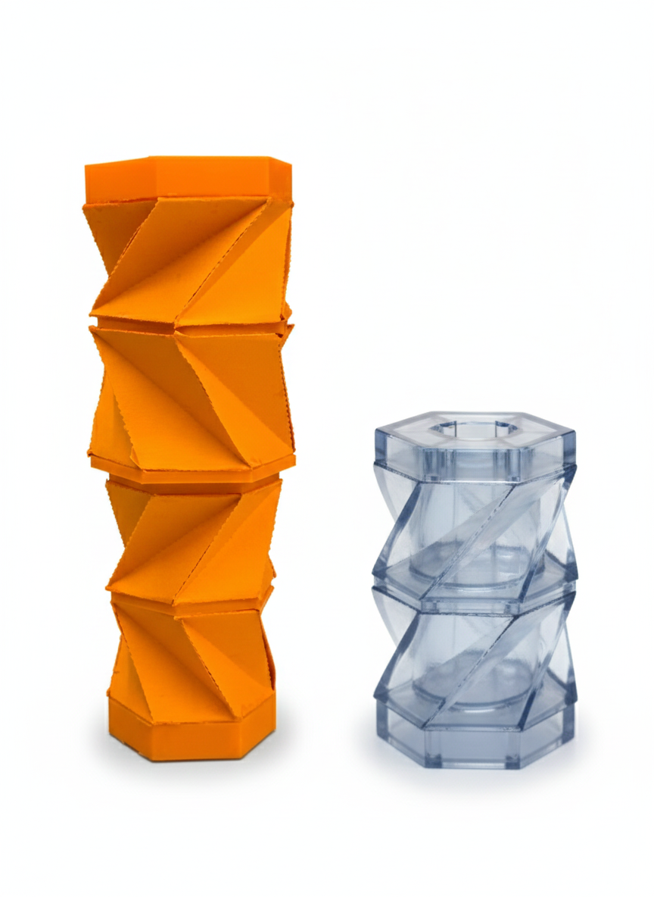
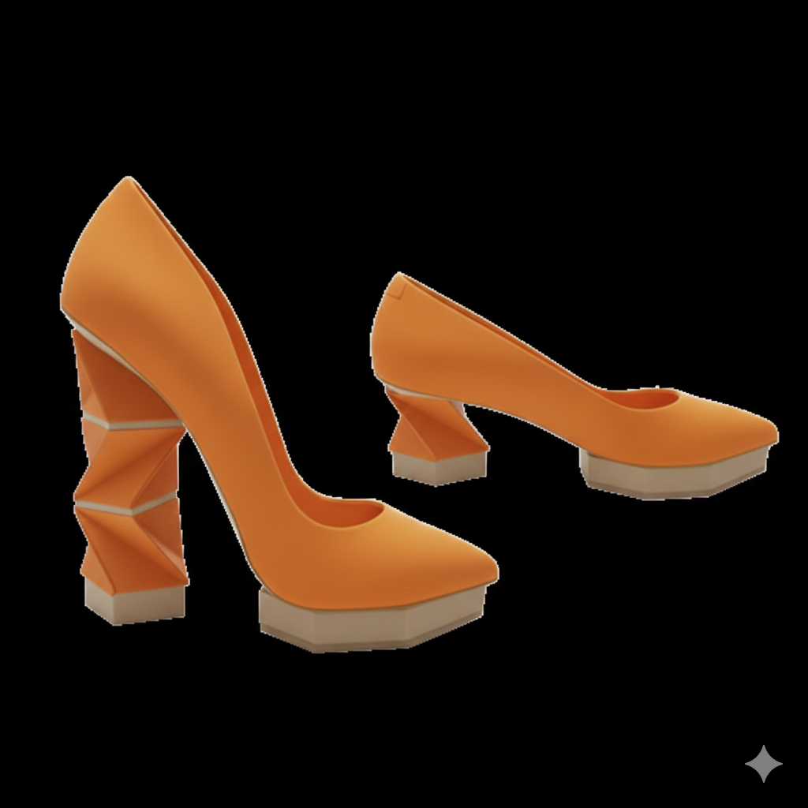

# Collapsible Kresling Heel

**Origami-inspired adjustable heel using stacked Kresling modules, geometric modeling, CAD, and physical prototyping.**

This project explored whether a **Kresling origami structure** could serve as a transformable heel that changes height through twist-extension motion. The concept was developed as a team final project in an origami engineering course and combined geometry, MATLAB modeling, CAD, fabrication, and physical testing.

<p align="center">
  
  
</p>

[**View the final project poster →**](poster/collapsible_kresling_heel_poster.pdf)

---

## Design Motivation

Conventional heels typically provide a fixed height, so changing heel height usually requires a different pair of shoes. Our concept investigated a modular alternative: a **collapsible heel made from stacked Kresling cells** that could move between extended and collapsed configurations.

The intended design goals were:

- multiple heel-height states within one footwear concept;
- compact collapse through origami-inspired geometry;
- reduced material use relative to owning several separate heel heights;
- stable vertical support in the deployed configuration; and
- a simple locking/support mechanism that could be removed to allow collapse.

The course concept targeted **four height options in one shoe** by combining stackable modules.

---

## Mechanical Architecture

The prototype uses a **hexagonal Kresling shell** with a removable central support rod.

Key features include:

- **6-sided Kresling geometry** (`m = 6`);
- a **central removable rod** for vertical support;
- magnets that help self-align the rod and interface;
- top and bottom plates that constrain the folded shell;
- modules of **opposite chirality** to reduce net twisting of the user-facing structure; and
- partially folded panels intended to improve lateral stiffness.

<p align="center">
  
  
</p>

---

## Geometric Modeling

A MATLAB script was used to generate the Kresling geometry and evaluate whether a selected parameter set produced a feasible configuration.

The model uses:

- `a` — top polygon edge length;
- `b` — diagonal / folded facet length used in the geometric construction;
- `beta` — crease angle;
- `m` — polygon side count;
- `phi` — twist angle;
- `h` — deployed height;
- `r` — circumscribed radius; and
- `chirality` — positive or negative twist orientation.

The script computes the twist angle, deployed height, vertex coordinates, and triangular facets, then renders the resulting shell geometry.

For the large prototype, the final poster reports approximately:

| Parameter | Value |
|---|---:|
| `m` | 6 |
| `a` | 3.0 cm |
| `b` | 4.249 cm |
| `beta` | 110.5° |
| `phi` | about -55° |
| `h` | about 3.23 cm |

The smaller prototype preserved the same geometric ratios with `a = 2.5 cm` and `b = 3.54 cm`.

[**View the MATLAB geometry model →**](src/kresling_geometry_model.m)

---

## CAD & Prototyping

Two prototype scales are included in both Fusion 360 and STL format:

- [`cad/large/`](cad/large/) — larger second-generation prototype
- [`cad/small/`](cad/small/) — smaller second-generation prototype

The physical prototypes combined **3D-printed end components, folded shell panels, a removable rod, and magnets**. Iteration focused on geometric accuracy, chirality alignment, panel stiffness, magnet strength, collapse behavior, and the rod interface.

---

## Prototype Observations

According to the final project poster, the prototype demonstrated:

- stable vertical load-bearing when the support rod was inserted;
- smooth deploy-to-collapse motion when the rod was removed;
- self-alignment of the rod using magnets;
- height behavior consistent with the MATLAB geometry prediction; and
- reduced sway when opposite-chirality modules were combined.

The work also exposed several practical limitations:

- Kresling behavior was highly sensitive to crease angle and fabrication error;
- small alignment errors created large assembly problems;
- lateral stiffness remained dependent on the central rod;
- the collapsed height was still significant because of joints and rod housing; and
- full footwear integration, including comfort and changing foot inclination, remained unresolved.

These limitations are important: this repository documents a **functional mechanism prototype and design exploration**, not a validated or wearable commercial shoe.

---

## Concept Visualizations

The project also explored how the mechanism might appear when integrated into footwear. Selected AI-assisted concept visualizations are included in [`media/concept/`](media/concept/).

<p align="center">
  
  
</p>

These are **concept illustrations only**. They are not photographs of fabricated shoes and are not used as evidence of mechanical performance.

---

## Repository Structure

```text
kresling-collapsible-heel/
├── README.md
├── LICENSE_NOTICE.md
├── poster/
│   └── collapsible_kresling_heel_poster.pdf
├── src/
│   └── kresling_geometry_model.m
├── cad/
│   ├── large/
│   │   ├── large_prototype.f3d
│   │   └── large_prototype.stl
│   └── small/
│       ├── small_prototype.f3d
│       └── small_prototype.stl
└── media/
    ├── prototype/
    └── concept/
```

---

## Skills & Methods

`Origami Engineering` · `Kresling Geometry` · `MATLAB` · `Fusion 360` · `CAD` · `3D Printing` · `Rapid Prototyping` · `Mechanical Design` · `Design Iteration`

---

## Team Attribution

This was a **team course project** completed by:

- Jeonghyun Park
- Cindy Zhao
- Alessandra Faccone
- Kelsey Campbell

This repository preserves the original team attribution while organizing the project as part of my engineering portfolio.

---

## Future Work

A stronger next iteration would focus on:

- quantitative compression and lateral-stiffness testing;
- a more compact locking mechanism;
- improved crease/facet manufacturing accuracy;
- flexible polymers or composite shell materials;
- fatigue testing over repeated deploy-collapse cycles; and
- footwear-level integration that accounts for comfort, foot angle, and walking stability.
